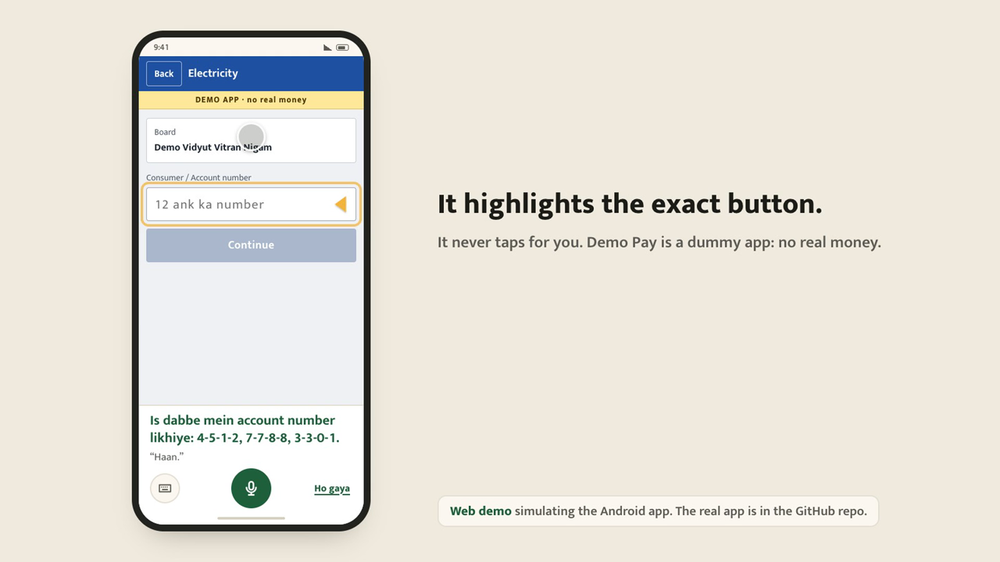

# Batao Kaise

**Speak, and your phone shows you how.** Batao Kaise is a voice-first helper for people in rural India who own a phone but can't use it fully: elders, daily-wage workers, homemakers and small shopkeepers. You press one button and say what you need in Hindi or Hinglish. It repeats what it heard, waits for your "Haan", then does the task with you, one step at a time. It never taps for you.

> **Live web demo:** _URL added after deploy_ · **Video:** _YouTube link added after upload_ (file: [`docs/video/batao-kaise-demo.mp4`](docs/video/batao-kaise-demo.mp4), 2:59) · **Deck:** [`docs/deck.pdf`](docs/deck.pdf)



## The one core workflow

```
tap mic → "Batao, kya karna hai?" → you speak → it reads back ("…Sahi?") → Haan → it does it, step by step
```

The same workflow can do three things when asked:

| You say | What happens |
|---|---|
| "Ramesh ko do sau udhaar" | Asks "Ramesh Kumar ya Ramesh Yadav?", reads back "Ramesh Kumar, 200 rupaye udhaar. Sahi?", then saves it. "Kiska kitna baaki hai?" reads the top balances aloud. "Ramesh se paisa kaise loon?" drafts a polite WhatsApp reminder with a UPI QR, and you press Send. |
| "Bijli ka bill bharna hai" | Reads the bill aloud with coloured boxes (account number digit by digit, amount, due date; unclear fields are marked "Saaf nahi", never guessed), then guides you through Demo Pay by highlighting Bills → Electricity → account field → Pay. It steps back on the PIN screen: "Ye aap khud daaliye." |
| "Main atak gaya" (or a step fails twice, or it doesn't know the task) | The Rescue Circle builds a summary from the task state (not a screenshot), removes OTPs, PINs and account, Aadhaar, phone and UPI numbers, reads it to you, asks "Bhej doon?", and you share it with someone you trust. |

Safety rules built into the loop: nothing happens before "Haan". Amounts over ₹2,000 get a second check. After noise or two "Nahi"s it shows picture buttons instead of guessing. "Ruko", "phir se", "peeche" and "naya kaam" work anywhere.

## Run it (no keys needed)

1. Install Node 20+.
2. `cd web-demo`
3. `npm install`
4. `npm run dev`, then open the printed URL in **Chrome** (the Web Speech API needs Chrome or Edge for the hi-IN mic).
5. Allow the microphone, tap the mic and speak, or use the "type instead" box.

Tests: `cd web-demo && npx vitest run`. These drive the full workflow (udhaar, bill + guided Demo Pay, Rescue Circle) plus 20 test phrases covering accents, code-mixing, noise words and wrong names, as well as the redactor and the bill parser.

## What's real and what's mocked

| Part | Status |
|---|---|
| Voice loop, read-back, confirmations, error handling | **Real** (engine in `web-demo/src/engine`) |
| Hindi/Hinglish understanding: Devanagari→Hinglish, synonyms (udhaar = udhari, baaki, karja…), spoken numbers ("dhai sau" = 250) | **Real**, rule-based, offline |
| Speech in/out | **Real**: browser Web Speech API (hi-IN) and speechSynthesis. Typing is the fallback. |
| Udhaar ledger | **Real**, stored in your browser (seeded with fake customers) |
| Redaction | **Real**, unit-tested with fake numbers only |
| Bill reading | Parser is **real**. In the web demo the OCR text of the sample bill is **precomputed**; the Android code uses on-device ML Kit. |
| Demo Pay | **Mock** UPI app, "DEMO, no real money". No bank or UPI app is ever used. |
| WhatsApp share, Gemini/Claude question | **Mock** share sheet in the web demo |
| Android app (`app/`, `demo-upi/`) | Reference implementation of the same workflow (Kotlin, Compose, Accessibility overlay guide, ML Kit, SQLCipher). It builds and its unit tests pass, but it is **untested on a device** and is not part of this submission's demo. |
| Wispr Flow voice API, LLM intent | **Not built** (stubs only). Demo Mode uses Android/browser speech and rules. |

## Repo map

- `web-demo/`: the submission demo (Vite + React). `src/engine/` is all the logic; the UI only handles I/O.
- `app/`, `demo-upi/`: Android reference implementation (Kotlin).
- `assets/demo/`: fake sample bill and seeded ledger.
- `docs/`: spec, demo script, pitch deck.

## Privacy

No analytics and no accounts. Audio is never stored. The PIN is never stored (the demo keeps only its length). Nothing leaves the device unless you choose to share it, and shared summaries are redacted first.

## License

MIT, see [LICENSE](LICENSE).
